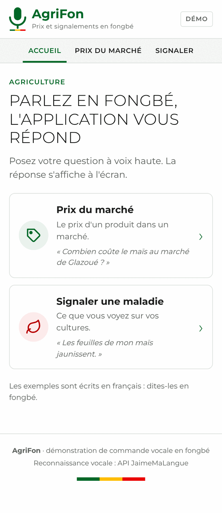
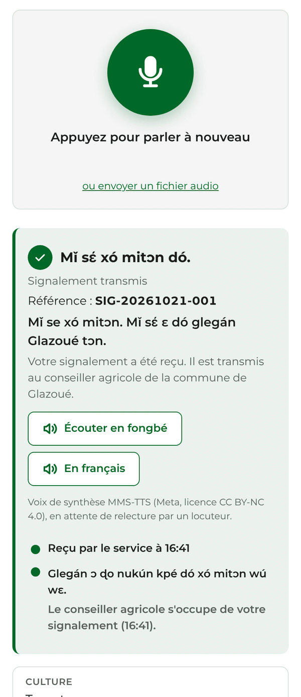
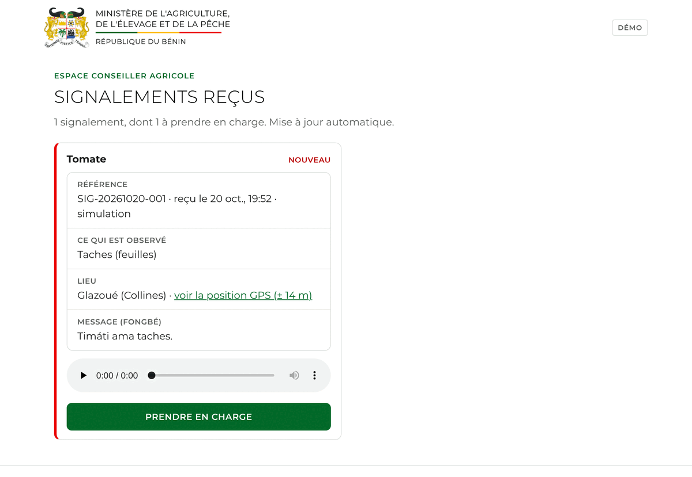
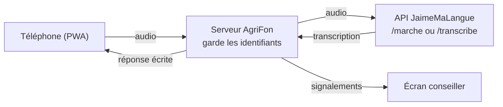

# AgriFon

Démo de commande vocale en fongbé pour l'agriculture. On parle à son téléphone pour connaître le prix d'un produit sur un marché, ou pour signaler une maladie sur ses cultures. La réponse s'affiche à l'écran en fongbé, avec sa traduction en français, et peut être écoutée en fongbé.

L'application est une PWA (application web installable sur téléphone). La reconnaissance vocale du fongbé est assurée par l'API JaimeMaLangue.

<table>
  <tr>
    <td align="center"></td>
    <td align="center"></td>
    <td align="center"></td>
  </tr>
  <tr>
    <td align="center">Accueil</td>
    <td align="center">Prix du marché</td>
    <td align="center">Signalement</td>
  </tr>
</table>

<sub>Captures réalisées en mode simulation (transcriptions factices, prix réels), bandeau « Mode simulation » masqué.</sub>

## Les deux démos

| Démo | La personne dit (en fongbé) | Ce qui est extrait | Ce que fait le système |
| --- | --- | --- | --- |
| Prix du marché | « Combien coûte le maïs au marché de Glazoué ? » | le produit et le marché | cherche le dernier prix relevé et l'affiche |
| Signalement d'une maladie des cultures | « Les feuilles de mon maïs jaunissent. » | la culture et le symptôme | transmet le signalement localisé au conseiller agricole, confirme la réception et propose des solutions adaptées à la culture, au symptôme et à la saison |

Un écran conseiller (`/conseiller`) reçoit les signalements en direct. Quand le conseiller prend un signalement en charge, le téléphone de la personne affiche « Pris en charge par le conseiller ».

<p align="center"></p>

## Démarrage

Il faut Node.js 20.12 ou plus récent. Le projet n'a aucune dépendance npm.

```bash
git clone https://github.com/Magloire04/demo_agriculture.git
cd demo_agriculture
cp .env.example .env    # puis renseigner ASR_ID et ASR_MDP
npm start
```

- Application : http://localhost:3000
- Écran conseiller : http://localhost:3000/conseiller

### Configuration

Le fichier `.env` est lu au démarrage. Il est ignoré par Git : les identifiants de l'API ne doivent jamais être commités ni écrits dans le code de l'application.

| Variable | Rôle | Valeur par défaut |
| --- | --- | --- |
| `ASR_ID`, `ASR_MDP` | identifiants de l'API de reconnaissance vocale (transmis séparément) | aucune |
| `ASR_URL` | adresse de l'API | `https://51-159-167-70.sslip.io` |
| `ASR_SIMULATION` | `1` pour des réponses factices, sans appel à l'API | désactivé |
| `PORT`, `HOST` | port et interface d'écoute | `3000`, `0.0.0.0` |
| `DOSSIER_DONNEES` | dossier des signalements, de leurs audios et des prix importés | `stockage` |
| `CODE_CONSEILLER` | si renseigné, l'écran conseiller demande ce code | aucun |
| `SOLUTIONS_BROUILLON` | `1` pour proposer les solutions après un signalement avant la relecture de leur fon | désactivé |

### Essayer sans identifiants

```bash
npm run simulation
```

L'interface fonctionne avec des réponses factices et un bandeau « Mode simulation » le signale.

### Sur un téléphone

Les navigateurs n'autorisent le micro que sur une adresse en https (ou sur `localhost`). Pour la démo, il faut donc servir l'application en https, avec un certificat valide. Trois possibilités :

- un tunnel, par exemple `cloudflared tunnel --url http://localhost:3000`, qui donne une adresse https publique ;
- un reverse proxy (Caddy, nginx) avec certificat, sur un serveur ;
- un hébergement cPanel qui propose « Setup Node.js App » (voir la section suivante).

Ouverte en https, l'application peut être ajoutée à l'écran d'accueil du téléphone.

### Mettre en ligne sur un hébergement cPanel

Le script `scripts/deployer.sh` installe et met à jour l'application sur un hébergement cPanel avec « Setup Node.js App » (CloudLinux). Le domaine doit déjà exister dans cPanel, avec son certificat https. Se connecter au serveur en SSH, puis :

```bash
git clone https://github.com/Magloire04/demo_agriculture.git ~/agrifon-app
cd ~/agrifon-app && bash scripts/deployer.sh mon-domaine.example
```

Au premier passage, le script demande les identifiants de l'API et crée `.env`, lisible par le seul compte. Il déclare ensuite l'application Node.js avec la version la plus récente proposée (20.12 au minimum) et le fichier de démarrage `app.cjs`, importe les derniers prix (voir « Prix réels »), redémarre l'application et vérifie que `/api/etat` répond.

Pour mettre à jour le site, relancer la seconde commande : le code est récupéré depuis GitHub, `.env` et `stockage/` sont conservés.

Pour importer les prix chaque semaine sans redéployer, ajouter cette tâche dans « Cron Jobs » de cPanel (ici le lundi à 6 h 17) :

```
17 6 * * 1 bash $HOME/agrifon-app/scripts/importer-prix.sh >> $HOME/agrifon-app/stockage/import-prix.log 2>&1
```

## Déroulé de la démo

1. Ouvrir `/conseiller` sur l'écran de la salle.
2. Sur le téléphone, ouvrir « Prix du marché ». Appuyer sur le micro, dire la phrase, appuyer de nouveau. La réponse s'affiche, par exemple « Au marché de Glazoué, le maïs coûte 90 F CFA le kilo », avec le prix en grands caractères, le mois du relevé et l'évolution depuis le relevé précédent. « Écouter en fongbé » dit la réponse à voix haute. Toucher « Comparer avec les autres marchés » affiche les prix des autres marchés.
3. Ouvrir « Signaler », partager la position ou choisir la commune, puis dire la phrase. Le téléphone confirme la réception avec une référence, puis la section « En attendant le conseiller, vous pouvez : » propose des solutions, qu'« Écouter en fongbé » dit à voix haute. Le signalement apparaît sur l'écran conseiller avec la transcription, le message vocal et les solutions proposées.
4. Sur l'écran conseiller, cliquer sur « Prendre en charge ». Quelques secondes plus tard, le téléphone affiche « Pris en charge par le conseiller ».

Un enregistrement dure 30 secondes au plus. Le lien « ou envoyer un fichier audio » permet d'envoyer une phrase enregistrée à l'avance si la salle est bruyante.

## Préparer le vocabulaire en fongbé

L'application retrouve les mots attendus dans la transcription, sans tenir compte des tons. Pour les produits, les marchés, les cultures et les communes, elle accepte aussi une petite différence d'orthographe. Pour les symptômes et les parties de la plante, elle exige la suite de mots exacte : beaucoup de ces mots sont courts ou courants en fon, et une tolérance les ferait trouver à tort (« wànvú », chenille, dans « wan nu »). Les listes suivantes sont à vérifier et à compléter par des locuteurs du fongbé avant le jour de la démo.

| Liste | Fichier | État |
| --- | --- | --- |
| Symptômes | `data/lexique.json`, champ `fon` des `symptomes` | 9 symptômes : 49 termes fon pour les 8 premiers (koklojonɔ, fyɔ́, xú, wànvú, gblé…), tirés de textes publiés, à faire valider ; « Plante parasite (striga) » n'a encore que des termes français |
| Parties de la plante | `data/lexique.json`, champ `fon` des `parties` | ama, atínkàn, atínɖɔ̀, sínsɛ́n… ; racine (« ɖɔ̀ ») écarté car confondu avec « ɖɔ » (dire) |
| Cultures | `data/lexique.json`, champ `fon` des `cultures` | quelques noms courants (gbadé, mɔlikun, azin…) à vérifier |
| Produits | `data/referentiel.json`, champ `termes_fon` | 33 produits ; les 20 derniers ajoutés d'après le corpus FFR et le dictionnaire edutechbenin, à vérifier. Carotte, pomme de terre et farine de blé se disent en français, sans mot fon attesté |
| Marchés | `data/referentiel.json`, champ `termes` | variantes de prononciation des noms de lieux |
| Communes | `data/communes.json`, champ `termes` | noms officiels ; variantes pour 13 communes sur 77 seulement |
| Réponses affichées | `data/reponses.json`, champ `fon` | 15 phrases et 2 unités, rédigées d'après des sources publiées, à faire relire |
| Noms des produits | `data/referentiel.json`, champ `nom_fon` | affichés à côté du nom français, à faire relire |
| Solutions proposées | `data/solutions.json`, champs `fon` et `voix` | 84 textes (phrases, gestes, problèmes, traitements) rédigés en brouillon, **à faire relire avant la mise en ligne** (voir « Solutions proposées ») |

Méthode : dire chaque phrase de démonstration dans l'application, lire la ligne « Vous avez dit : … », ajouter les mots tels qu'ils y sont transcrits dans le fichier concerné, puis redémarrer le serveur.

Quand un symptôme n'est pas reconnu, le signalement est quand même transmis, marqué « à préciser ». Le conseiller dispose de la transcription et du message vocal.

Les termes des symptômes viennent du corpus fon-français FFR, du dictionnaire edutechbenin.com, de la Bible en fon (jw.org) et des vidéos en fon d'Access Agriculture. Chacun a été passé sur les 78 000 phrases du corpus FFR pour écarter ceux qui se confondent avec des mots courants. Exemple réel : « Mɔ̌likún ce sín ama fí ɔ́ » est compris comme « les feuilles de mon riz se dessèchent », la reconnaissance vocale ayant coupé le verbe « fyɔ́ » en « fí ɔ́ ».

Les phrases fongbé de `data/reponses.json` ont été rédigées à partir de textes publiés en fɔngbè (jw.org, corpus fon-français FFR, dictionnaire fongbebenin.com, guide Peace Corps), mais aucune n'a encore été relue par un locuteur natif. Pour en corriger une, modifier le champ `fon` en gardant les `{…}`, puis redémarrer le serveur. Une phrase fongbé mise à `null` n'est plus affichée : seul le français reste.

## Fonctionnement



Le téléphone n'appelle jamais l'API directement : il envoie l'audio au serveur AgriFon, qui ajoute les identifiants, comme l'exige la documentation de l'API. Le serveur n'envoie qu'une requête à la fois, car l'API traite les phrases une par une. Les codes d'erreur de l'API (audio trop court, trop long, service indisponible…) sont traduits en messages lisibles.

Prix du marché (`server/prix.js`). L'audio part vers le mode marché de l'API (`POST /marche`), qui rend les produits reconnus dans son lexique. Le produit est rapproché du référentiel des produits et le marché est cherché dans la transcription. Sans marché, la réponse donne la fourchette de prix et le marché le moins cher. Avec un marché mais sans produit, elle liste tous les prix de ce marché.

Signalement (`server/signalement.js`). L'audio part vers le modèle général (`POST /transcribe`). La culture, la partie de la plante, le symptôme et la commune sont cherchés dans la transcription. Le signalement est enregistré dans `stockage/` avec la position GPS, la commune et le message vocal. Si une commune est choisie, les communes du même département sont transmises à l'API (paramètre `noms`) pour l'aider à reconnaître un nom de lieu.

Réponses (`server/reponses.js`). Chaque réponse est construite dans les deux langues à partir des phrases-modèles de `data/reponses.json`, dont les `{…}` reçoivent le produit, le marché, le prix ou la commune. L'écran affiche le fongbé en grand, puis le français. Les montants restent écrits en chiffres, comme dans les textes publiés en fongbé.

### Prix réels

Les prix viennent du jeu de données « Benin - Food Prices » du Programme alimentaire mondial (PAM), publié sur [HDX](https://data.humdata.org/dataset/wfp-food-prices-for-benin) sous licence CC BY-IGO. Ce sont des prix de détail moyens en F CFA, relevés une fois par mois. Sous chaque réponse, l'application indique le mois du relevé et la source.

- `data/referentiel.json` décrit les 33 produits et les 14 marchés de l'application, avec leurs noms en fongbé et le libellé correspondant dans le fichier du PAM (champ `pam`). Lokossa n'est pas suivi par le PAM : l'application répond qu'aucun prix n'y est relevé, puis donne ceux des autres marchés. Les produits sont ceux que le PAM relève dans la plupart de nos marchés : céréales et farines, tubercules, légumineuses, légumes, fruits, poissons et huiles. Quand un mot fon désigne plusieurs produits relevés, l'application donne le prix de chacun : « mɔ̌likún » donne le riz local et le riz importé, « hweví » (poisson) le chinchard et la carpe. La série « Peas (green, dry) » du PAM correspond au pois d'Angole : ses prix sont ceux que la DSA publie pour ce produit.
- `scripts/importer-prix.js` télécharge le fichier CSV du PAM. Pour chaque produit et chaque marché, il garde le dernier relevé de moins de six mois et le relevé précédent, puis écrit `stockage/releves-prix.json`. Le serveur relit ce fichier dès qu'il change, sans redémarrage. Si l'import échoue, les prix précédents restent en place.
- `data/releves-prix.json` est un instantané livré avec le code (relevés jusqu'au 15 septembre 2026). Le serveur s'en sert tant qu'aucun import n'a eu lieu.

```bash
npm run importer-prix
```

### Réponse à voix haute

Le bouton « Écouter en fongbé » dit la réponse avec des extraits audio préparés à l'avance (`public/voix`, 460 fichiers MP3, 7,7 Mo). Le champ `voix` de `data/reponses.json` reprend chaque phrase fon, coupée en morceaux par `|` : « È nɔ sa gbadé kilo ɖokpó yí | 90 | ɖo Glazoué axi mɛ. ». Le serveur rend la liste des fichiers à enchaîner, et le téléphone les lit l'un après l'autre (`public/js/voix.js`). S'il manque un seul extrait, le bouton n'apparaît pas. Le serveur regarde le dossier à chaque réponse : un extrait ajouté, remplacé ou retiré compte tout de suite, sans redémarrage.

Les prix sont dits comme au marché, en kpɔ́nwun (25 F), ɖɔ̌la (5 F) et caki (1 000 F) : 90 F se dit « kpɔ́nwun atɔ̀n ɖɔ̌la atɔ̀n », 1 500 F « caki ɖokpó adaɖé » (`server/nombres-fon.js`, règles du guide de fon du Corps de la Paix, des dictionnaires fongbebenin.com et edutechbenin.com et de la presse traduite en fon). Le prix est arrondi à 5 F à l'oral, suivi de « mɔ̌ » (environ) quand on arrondit ; l'écran garde le prix exact.

Les extraits actuels sont produits par la voix de synthèse fon FongLab (API `https://tts.princespecial.me`, voix A1 apprise sur une lecture de la Bible), dont le modèle est sous licence CC BY-NC 4.0 (usage non commercial). L'application le signale sous le bouton. Ils remplacent ceux de [MMS-TTS](https://huggingface.co/facebook/mms-tts-fon), la voix de Meta, sous la même licence.

Chaque extrait a été relu par la reconnaissance vocale JaimeMaLangue (`scripts/voix/evaluer.js` : distance d'édition entre le texte attendu et le texte entendu, sans tons ni accents). La version la mieux comprise a été gardée parmi celles produites avec la graine 0, avec un point final pour les 286 extraits qui n'ont pas de ponctuation, puis avec les graines 1 et 2 pour les 121 extraits encore mal compris. Sans point final, la voix avale souvent les textes courts. Écart moyen obtenu : 7,0 % sur les montants et 13,0 % sur les phrases, contre 8,8 % et 15,0 % pour les extraits MMS-TTS relus de la même façon (ceux-ci n'avaient eu d'autres graines que pour les 34 plus mal relus). « ɖɔ̌la wè » et « ɖɔ̌la tɛ́nnɛ » restent les montants les plus mal rendus. La voix reste à faire valider par des locuteurs.

Pour remplacer la voix de synthèse par une voix humaine, faire enregistrer chaque texte de la liste et déposer le fichier sous le même nom : le nom d'un extrait se déduit du texte qu'il dit, aucun code n'est à modifier. La voix de synthèse ne connaît pas le « r » : le générateur le fait dire « l » (Palakou, kalotte), comme on le prononce en fon.

```bash
node scripts/lister-voix.js --json liste.json   # textes à dire et noms de fichier, extraits manquants
node scripts/voix/generer.js --point            # génère les manquants avec l'API de synthèse FongLab (sur un poste avec ffmpeg)
node scripts/voix/evaluer.js                    # fait relire les extraits par JaimeMaLangue, liste les plus mal compris
```

Un extrait mal compris se regénère avec une autre graine, par exemple `node scripts/voix/generer.js --point --graine 1 --refaire <fichier>.mp3`. La clé de l'API FongLab (`FONGLAB_TTS_API_KEY`) et les identifiants de JaimeMaLangue se renseignent dans le `.env` du poste. Le compte FongLab dispose de 50 000 caractères par mois : la liste complète en compte environ 12 000.

Après une modification de `data/reponses.json` ou de `data/solutions.json`, ou l'ajout d'un produit, d'un marché ou d'une commune, relancer ces deux commandes.

### Solutions proposées

Après un signalement où la culture et au moins un symptôme sont reconnus, la réponse ajoute une section « En attendant le conseiller, vous pouvez : » (`server/solutions.js`, données dans `data/solutions.json`). Elle contient au plus 4 éléments, en fongbé et en français, chacun avec sa source, et se termine toujours par « À confirmer avec un conseiller ». L'écran conseiller montre les mêmes solutions, enregistrées avec le signalement, et les réserves de chaque traitement.

- **Problème probable.** Quand la culture, le symptôme et, si besoin, la partie de la plante désignent un cas documenté, la section le nomme comme une hypothèse : « C'est probablement … » quand le cas est net, « Ce peut être … » sinon. Un cas peut exiger un mot précis dans la transcription (« puceron » pour le coton).
- **Traitement documenté (niveau 1).** Seulement pour un cas net, et seulement si la source est un document fait pour le Bénin (fiches et guides de l'INRAB et du ministère de l'Agriculture, guides de la FAO). Les doses sont recopiées telles que la source les écrit. Au lancement : jus d'ail sur l'amarante et le gboma, extrait de neem ou de papayer sur le niébé, extrait d'amande de neem sur le coton quand l'agriculteur parle de pucerons, spinosad sur la tomate contre Helicoverpa.
- **Gestes sans risque (niveau 2).** Pour chaque culture et chaque symptôme, au moins deux gestes tirés des sources reconnues (INRAB, FAO, CABI Plantwise, Access Agriculture). Les gestes liés à une saison (arroser, drainer) ne s'affichent que si la commune est connue : `server/saison.js` donne la saison du département d'après les normales de Météo-Bénin (deux saisons des pluies au Sud et au Centre, une au Nord). Les mois de transition comptent comme saison inconnue.
- **Produits autorisés.** Un produit chimique n'est nommé que s'il passe `server/pesticides.js` : même matière active à la même concentration qu'un produit de la première liste régionale du COAHP (version 2023, 844 produits), autorisé pour la culture et le ravageur, et absent des interdits nationaux (endosulfan, dichlorvos, polluants organiques persistants). La liste est extraite dans `data/pesticides.json` par `python scripts/pesticides/extraire_coahp.py <liste.pdf> data/pesticides.json` (sur un poste, avec `pypdf`). Un test refuse toute donnée qui ne respecte pas cette règle.
- **Vidéos.** Quand Access Agriculture publie une vidéo en fon sur le problème, un lien « Voir la vidéo en fon » y renvoie. Leur contenu, tous droits réservés, n'est pas repris.

Le fongbé des solutions est un brouillon (`"fon_a_relire": true` dans `data/solutions.json`) : il doit être relu par un locuteur avant la mise en ligne. Tant que ce drapeau vaut `true`, le serveur ne propose pas de solutions et l'indique au démarrage, sauf si `SOLUTIONS_BROUILLON=1` est défini (pour une démonstration). Après la relecture, mettre le drapeau à `false`.

```bash
node scripts/relecture-solutions.js exporter relecture.csv   # fiche à ouvrir dans un tableur : fr, fon, voix, source
node scripts/relecture-solutions.js importer relecture.csv   # reprend les colonnes fon et voix corrigées
```

Le locuteur corrige le fon affiché (doses en chiffres) et le texte dit par la voix (nombres en toutes lettres). L'import signale toute ligne dont l'un des deux a changé sans l'autre. Régénérer ensuite les extraits corrigés avec `scripts/voix/generer.js --point`.

### Routes du serveur

| Méthode | Adresse | Rôle |
| --- | --- | --- |
| `POST` | `/api/prix` | corps : l'audio (`Content-Type: audio/…`). Rend le produit, le marché, les prix et la phrase de réponse. |
| `POST` | `/api/signalements?lat=&lon=&precision=&commune=` | corps : l'audio. Enregistre le signalement et le rend, avec les solutions proposées (`solutions`, ou `null`). |
| `GET` | `/api/signalements/{référence}` | statut d'un signalement (suivi sur le téléphone) |
| `GET` | `/api/signalements` | liste des signalements (conseiller) |
| `POST` | `/api/signalements/{référence}/prise-en-charge` | prise en charge (conseiller) |
| `GET` | `/api/signalements/{référence}/audio` | message vocal (conseiller) |
| `GET` | `/api/prix/base`, `/api/communes`, `/api/etat` | données de référence et état du service |

Si `CODE_CONSEILLER` est défini, les routes du conseiller demandent ce code, dans l'en-tête `X-Code-Conseiller` ou le paramètre `code`. La page `/conseiller` le demande à l'ouverture.

## Charte graphique

L'interface reprend les éléments de la charte graphique du Gouvernement du Bénin :

- police Montserrat (Light pour les titres en capitales, Regular pour le texte), incluse dans `public/fonts/` ;
- couleurs du drapeau (vert `#006828`, jaune `#FFBE00`, rouge `#EB0000`), complétées par le noir ;
- bande tricolore courte (un tiers de la largeur), centrée en bas de page, comme sur les documents des ministères ;
- mise en page reprise du modèle « site internet ministère » : logo en haut à gauche, barre de rubriques grise.

L'en-tête porte le logo d'AgriFon (`public/img/logo-agrifon.svg`) : le micro de l'icône de l'application, au-dessus d'une bande tricolore, suivi du nom AgriFon. L'application n'affiche ni armoiries ni nom de ministère.

## Arborescence

```
app.cjs             point d'entrée pour les hébergeurs qui chargent l'application avec require()
scripts/
  deployer.sh       installation et mise à jour sur un hébergement cPanel
  importer-prix.js  import des prix du PAM
  importer-prix.sh  le même import, pour une tâche planifiée cPanel
  lister-voix.js    extraits audio que les réponses peuvent dire, et ceux qui manquent
  voix/generer.js   génération des extraits avec l'API de synthèse fon FongLab (sur un poste)
  voix/evaluer.js   relecture des extraits par la reconnaissance vocale, écart avec le texte attendu
  relecture-solutions.js  export et réimport CSV des solutions pour le locuteur (relecture/csv.js)
  pesticides/extraire_coahp.py  extraction de la liste COAHP vers data/pesticides.json (sur un poste)
server/
  index.js          serveur HTTP : fichiers de la PWA et routes /api
  asr.js            client de l'API de reconnaissance vocale (et mode simulation)
  prix.js           réponse « prix du marché »
  pam.js            lecture du fichier de prix du PAM
  releves.js        relevés de prix lus par le serveur, relus à chaque import
  reponses.js       phrases de réponse en français et en fongbé
  nombres-fon.js    prix dits en fon (kpɔ́nwun, ɖɔ̌la, caki)
  voix.js           extraits audio à enchaîner pour dire une réponse
  signalement.js    analyse et registre des signalements
  solutions.js      solutions proposées après un signalement
  saison.js         saison des pluies ou saison sèche d'un département
  pesticides.js     règle d'autorisation d'un produit nommé
  texte.js          comparaison de mots sans tons ni accents
data/
  referentiel.json  produits et marchés, avec leurs libellés dans le fichier du PAM
  releves-prix.json instantané des prix du PAM
  lexique.json      cultures, parties de la plante, symptômes
  reponses.json     phrases de réponse en français et en fongbé
  communes.json     les 77 communes du Bénin
  solutions.json    sources, gestes, problèmes et traitements proposés après un signalement
  pesticides.json   produits de la liste COAHP et interdits nationaux
public/
  index.html        application (accueil, prix, signalement)
  conseiller.html   écran conseiller
  css/, js/, fonts/, img/, icons/
  voix/             extraits audio des réponses en fongbé
  manifest.webmanifest, sw.js
test/               tests (node --test)
docs/captures/      captures d'écran du README
```

## Tests

```bash
npm test
```

Les 104 tests couvrent la comparaison de texte, les prix dits en fon, les extraits audio des réponses, la lecture du fichier du PAM, le rechargement des prix, la réponse « prix du marché » dans les deux langues, l'analyse et l'enregistrement des signalements, les routes du serveur et le client de l'API (authentification, erreurs, une requête à la fois). Pour les solutions proposées, ils vérifient aussi la saison par département, le choix des solutions (cas net ou possible, mots déclencheurs, parties exigées, plafonds), la règle d'autorisation des produits, la couverture des 171 combinaisons culture × symptôme, la présence de chaque morceau de voix et l'export CSV pour la relecture.

## Limites connues

- Le vocabulaire fongbé des symptômes vient de textes publiés et n'a pas encore été validé par des agriculteurs ou des conseillers (voir « Préparer le vocabulaire en fongbé »).
- Les réponses en fongbé n'ont pas encore été relues par un locuteur natif.
- La voix de synthèse fon FongLab est apprise sur une lecture de la Bible : certains tons sonnent faux et des montants courts (ɖɔ̌la wè, ɖɔ̌la tɛ́nnɛ) sont parfois déformés. Sa licence interdit l'usage commercial. Une voix enregistrée par un locuteur est prévue pour la remplacer.
- Les prix sont mensuels : entre deux relevés du PAM, ils ne suivent pas les variations d'un jour à l'autre.
- Au dernier import, 31 couples produit × marché n'avaient pas de relevé récent, surtout à Pobè (riz local, manioc frais, banane plantain, pois d'Angole…). Pour ces cas, l'application le dit et donne les prix des autres marchés. `npm run importer-prix` affiche la liste à jour.
- Les signalements sont enregistrés dans un fichier JSON. Cela suffit pour une démo, pas pour un service en production.
- Les solutions proposées n'ont pas été validées par un agronome : elles reprennent les sources telles quelles, et la section rappelle toujours de les confirmer avec un conseiller. Le système reconnaît des symptômes généraux, pas des maladies : un problème n'est jamais présenté que comme une hypothèse.
- Le 22 octobre 2026, plusieurs sources étaient inaccessibles aux outils automatiques (fiches PlantwisePlus, site du ministère de l'Agriculture en maintenance, serveur des fiches de l'INRAB hors ligne). Le riz, l'arachide, le soja et l'ananas n'ont donc que des gestes sans risque, sans traitement nommé.
- La liste COAHP ne dit pas si un produit est encore en vente au Bénin, et la liste nationale de mars 2024 n'est pas publiée : chaque traitement chimique reste à confirmer auprès du conseiller.
- D'après la documentation de l'API, les nombres dits en français et les noms propres rares sont les points faibles de la reconnaissance.

## Licence

Le code est sous licence MIT (voir [LICENSE](LICENSE)). Les prix sont ceux du PAM, sous licence [CC BY-IGO](https://creativecommons.org/licenses/by/3.0/igo/), cités comme source dans l'application. La police Montserrat est distribuée sous licence SIL Open Font License ([public/fonts/OFL.txt](public/fonts/OFL.txt)). Les extraits audio de `public/voix` sont produits avec la voix de synthèse fon FongLab et suivent la licence de son modèle, [CC BY-NC 4.0](https://creativecommons.org/licenses/by-nc/4.0/).
