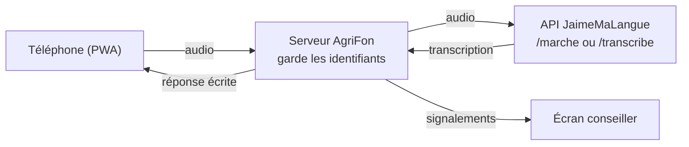

# AgriFon

Démo de commande vocale en fongbé pour l'agriculture. On parle à son téléphone pour connaître le prix d'un produit sur un marché, ou pour signaler une maladie sur ses cultures. La réponse s'affiche à l'écran.

L'application est une PWA (application web installable sur téléphone). La reconnaissance vocale du fongbé est assurée par l'API JaimeMaLangue.

<table>
  <tr>
    <td align="center"></td>
    <td align="center"></td>
    <td align="center"></td>
  </tr>
  <tr>
    <td align="center">Accueil</td>
    <td align="center">Prix du marché</td>
    <td align="center">Signalement</td>
  </tr>
</table>

<sub>Captures réalisées en mode simulation (réponses factices), bandeau « Mode simulation » masqué.</sub>

## Les deux démos

| Démo | La personne dit (en fongbé) | Ce qui est extrait | Ce que fait le système |
| --- | --- | --- | --- |
| Prix du marché | « Combien coûte le maïs au marché de Glazoué ? » | le produit et le marché | cherche le prix dans la base et l'affiche |
| Signalement d'une maladie des cultures | « Les feuilles de mon maïs jaunissent. » | la culture et le symptôme | transmet le signalement localisé au conseiller agricole et confirme la réception |

Un écran conseiller (`/conseiller`) reçoit les signalements en direct. Quand le conseiller prend un signalement en charge, le téléphone de la personne affiche « Pris en charge par le conseiller ».

<p align="center"></p>

## Démarrage

Il faut Node.js 20.12 ou plus récent. Le projet n'a aucune dépendance npm.

```bash
git clone https://github.com/Magloire04/demo_agriculture.git
cd demo_agriculture
cp .env.example .env    # puis renseigner ASR_ID et ASR_MDP
npm start
```

- Application : http://localhost:3000
- Écran conseiller : http://localhost:3000/conseiller

### Configuration

Le fichier `.env` est lu au démarrage. Il est ignoré par Git : les identifiants de l'API ne doivent jamais être commités ni écrits dans le code de l'application.

| Variable | Rôle | Valeur par défaut |
| --- | --- | --- |
| `ASR_ID`, `ASR_MDP` | identifiants de l'API de reconnaissance vocale (transmis séparément) | aucune |
| `ASR_URL` | adresse de l'API | `https://51-159-167-70.sslip.io` |
| `ASR_SIMULATION` | `1` pour des réponses factices, sans appel à l'API | désactivé |
| `PORT`, `HOST` | port et interface d'écoute | `3000`, `0.0.0.0` |
| `DOSSIER_DONNEES` | dossier des signalements et de leurs audios | `stockage` |
| `CODE_CONSEILLER` | si renseigné, l'écran conseiller demande ce code | aucun |

### Essayer sans identifiants

```bash
npm run simulation
```

L'interface fonctionne avec des réponses factices et un bandeau « Mode simulation » le signale.

### Sur un téléphone

Les navigateurs n'autorisent le micro que sur une adresse en https (ou sur `localhost`). Pour la démo, il faut donc servir l'application en https, avec un certificat valide. Deux possibilités :

- un tunnel, par exemple `cloudflared tunnel --url http://localhost:3000`, qui donne une adresse https publique ;
- un reverse proxy (Caddy, nginx) avec certificat, sur un serveur.

Ouverte en https, l'application peut être ajoutée à l'écran d'accueil du téléphone.

## Déroulé de la démo

1. Ouvrir `/conseiller` sur l'écran de la salle.
2. Sur le téléphone, ouvrir « Prix du marché ». Appuyer sur le micro, dire la phrase, appuyer de nouveau. La réponse s'affiche, par exemple « Au marché de Glazoué, le maïs coûte 250 F CFA le kilo », avec le prix en grands caractères. Toucher « Comparer avec les autres marchés » affiche les prix des autres marchés.
3. Ouvrir « Signaler », partager la position ou choisir la commune, puis dire la phrase. Le téléphone confirme la réception avec une référence. Le signalement apparaît sur l'écran conseiller avec la transcription et le message vocal.
4. Sur l'écran conseiller, cliquer sur « Prendre en charge ». Quelques secondes plus tard, le téléphone affiche « Pris en charge par le conseiller ».

Un enregistrement dure 30 secondes au plus. Le lien « ou envoyer un fichier audio » permet d'envoyer une phrase enregistrée à l'avance si la salle est bruyante.

## Préparer le vocabulaire en fongbé

L'application retrouve les mots attendus dans la transcription, sans tenir compte des tons et avec une petite tolérance sur l'orthographe. Les listes suivantes sont à vérifier et à compléter par des locuteurs du fongbé avant le jour de la démo.

| Liste | Fichier | État |
| --- | --- | --- |
| Symptômes | `data/lexique.json`, champ `fon` des `symptomes` | vide : seuls les mots français sont reconnus |
| Parties de la plante | `data/lexique.json`, champ `fon` des `parties` | seul « ama » (feuilles) ; tiges, racines et fruits vides |
| Cultures | `data/lexique.json`, champ `fon` des `cultures` | quelques noms courants (gbadé, mɔlikun, azin…) à vérifier |
| Produits | `data/prix.json`, champ `termes_fon` | idem |
| Marchés | `data/prix.json`, champ `termes` | variantes de prononciation des noms de lieux |
| Communes | `data/communes.json`, champ `termes` | noms officiels ; variantes pour 13 communes sur 77 seulement |

Méthode : dire chaque phrase de démonstration dans l'application, lire la ligne « Vous avez dit : … », ajouter les mots tels qu'ils y sont transcrits dans le fichier concerné, puis redémarrer le serveur.

Quand un symptôme n'est pas reconnu, le signalement est quand même transmis, marqué « à préciser ». Le conseiller dispose de la transcription et du message vocal.

## Fonctionnement



Le téléphone n'appelle jamais l'API directement : il envoie l'audio au serveur AgriFon, qui ajoute les identifiants, comme l'exige la documentation de l'API. Le serveur n'envoie qu'une requête à la fois, car l'API traite les phrases une par une. Les codes d'erreur de l'API (audio trop court, trop long, service indisponible…) sont traduits en messages lisibles.

Prix du marché (`server/prix.js`). L'audio part vers le mode marché de l'API (`POST /marche`), qui rend les produits reconnus dans son lexique. Le produit est rapproché de la base de prix et le marché est cherché dans la transcription. Sans marché, la réponse donne la fourchette de prix et le marché le moins cher. Avec un marché mais sans produit, elle liste tous les prix de ce marché.

Signalement (`server/signalement.js`). L'audio part vers le modèle général (`POST /transcribe`). La culture, la partie de la plante, le symptôme et la commune sont cherchés dans la transcription. Le signalement est enregistré dans `stockage/` avec la position GPS, la commune et le message vocal. Si une commune est choisie, les communes du même département sont transmises à l'API (paramètre `noms`) pour l'aider à reconnaître un nom de lieu.

Base de prix (`data/prix.json`). Ce sont des données de démonstration, fictives mais vraisemblables : 13 produits, 13 marchés, prix de la semaine et de la semaine précédente. L'application le rappelle sous chaque réponse. Elles sont à remplacer par un vrai relevé.

### Routes du serveur

| Méthode | Adresse | Rôle |
| --- | --- | --- |
| `POST` | `/api/prix` | corps : l'audio (`Content-Type: audio/…`). Rend le produit, le marché, les prix et la phrase de réponse. |
| `POST` | `/api/signalements?lat=&lon=&precision=&commune=` | corps : l'audio. Enregistre le signalement et le rend. |
| `GET` | `/api/signalements/{référence}` | statut d'un signalement (suivi sur le téléphone) |
| `GET` | `/api/signalements` | liste des signalements (conseiller) |
| `POST` | `/api/signalements/{référence}/prise-en-charge` | prise en charge (conseiller) |
| `GET` | `/api/signalements/{référence}/audio` | message vocal (conseiller) |
| `GET` | `/api/prix/base`, `/api/communes`, `/api/etat` | données de référence et état du service |

Si `CODE_CONSEILLER` est défini, les routes du conseiller demandent ce code, dans l'en-tête `X-Code-Conseiller` ou le paramètre `code`. La page `/conseiller` le demande à l'ouverture.

## Charte graphique

L'interface suit la charte graphique du Gouvernement du Bénin :

- police Montserrat (Light pour les titres en capitales, Regular pour le texte), incluse dans `public/fonts/` ;
- couleurs du drapeau (vert `#006828`, jaune `#FFBE00`, rouge `#EB0000`), complétées par le noir ;
- logotype de ministère : armoiries, libellé de l'institution, bande tricolore et « République du Bénin » ;
- bande tricolore courte (un tiers de la largeur), centrée en bas de page, comme sur les documents des ministères ;
- mise en page reprise du modèle « site internet ministère » : logo en haut à gauche, barre de rubriques grise.

Les armoiries (`public/img/armoiries.png`) sont extraites du PDF de la charte, sans retouche. La charte demande d'utiliser les fichiers officiels fournis par la Direction de la Communication : ils remplaceront ce fichier dès qu'ils seront disponibles. Le libellé de l'institution se modifie dans `public/index.html` et `public/conseiller.html`, à deux endroits dans chaque fichier : le texte du logotype (`logo-institution`) et l'attribut `aria-label` du lien du logo.

## Arborescence

```
server/
  index.js          serveur HTTP : fichiers de la PWA et routes /api
  asr.js            client de l'API de reconnaissance vocale (et mode simulation)
  prix.js           réponse « prix du marché »
  signalement.js    analyse et registre des signalements
  texte.js          comparaison de mots sans tons ni accents
data/
  prix.json         base de prix de démonstration (produits, marchés)
  lexique.json      cultures, parties de la plante, symptômes
  communes.json     les 77 communes du Bénin
public/
  index.html        application (accueil, prix, signalement)
  conseiller.html   écran conseiller
  css/, js/, fonts/, img/, icons/
  manifest.webmanifest, sw.js
test/               tests (node --test)
docs/captures/      captures d'écran du README
```

## Tests

```bash
npm test
```

Les 25 tests couvrent la comparaison de texte, la réponse « prix du marché », l'analyse et l'enregistrement des signalements, les routes du serveur et le client de l'API (authentification, erreurs, une requête à la fois).

## Limites connues

- Le vocabulaire fongbé des symptômes reste à fournir (voir « Préparer le vocabulaire en fongbé »).
- Les prix sont fictifs.
- Les signalements sont enregistrés dans un fichier JSON. Cela suffit pour une démo, pas pour un service en production.
- D'après la documentation de l'API, les nombres dits en français et les noms propres rares sont les points faibles de la reconnaissance.

## Licence

Le code est sous licence MIT (voir [LICENSE](LICENSE)). La police Montserrat est distribuée sous licence SIL Open Font License ([public/fonts/OFL.txt](public/fonts/OFL.txt)). Les armoiries sont l'emblème de la République du Bénin, utilisé ici selon la charte graphique du Gouvernement.
