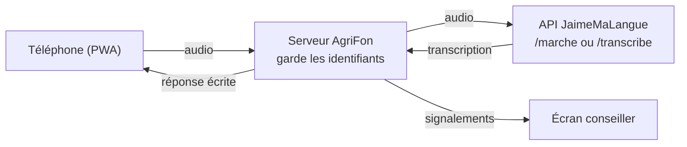

# AgriFon

Démo de commande vocale en fongbé pour l'agriculture. On parle à son téléphone pour connaître le prix d'un produit sur un marché, ou pour signaler une maladie sur ses cultures. La réponse s'affiche à l'écran en fongbé, avec sa traduction en français.

L'application est une PWA (application web installable sur téléphone). La reconnaissance vocale du fongbé est assurée par l'API JaimeMaLangue.

<table>
  <tr>
    <td align="center"></td>
    <td align="center"></td>
    <td align="center"></td>
  </tr>
  <tr>
    <td align="center">Accueil</td>
    <td align="center">Prix du marché</td>
    <td align="center">Signalement</td>
  </tr>
</table>

<sub>Captures réalisées en mode simulation (transcriptions factices, prix réels), bandeau « Mode simulation » masqué.</sub>

## Les deux démos

| Démo | La personne dit (en fongbé) | Ce qui est extrait | Ce que fait le système |
| --- | --- | --- | --- |
| Prix du marché | « Combien coûte le maïs au marché de Glazoué ? » | le produit et le marché | cherche le dernier prix relevé et l'affiche |
| Signalement d'une maladie des cultures | « Les feuilles de mon maïs jaunissent. » | la culture et le symptôme | transmet le signalement localisé au conseiller agricole et confirme la réception |

Un écran conseiller (`/conseiller`) reçoit les signalements en direct. Quand le conseiller prend un signalement en charge, le téléphone de la personne affiche « Pris en charge par le conseiller ».

<p align="center"></p>

## Démarrage

Il faut Node.js 20.12 ou plus récent. Le projet n'a aucune dépendance npm.

```bash
git clone https://github.com/Magloire04/demo_agriculture.git
cd demo_agriculture
cp .env.example .env    # puis renseigner ASR_ID et ASR_MDP
npm start
```

- Application : http://localhost:3000
- Écran conseiller : http://localhost:3000/conseiller

### Configuration

Le fichier `.env` est lu au démarrage. Il est ignoré par Git : les identifiants de l'API ne doivent jamais être commités ni écrits dans le code de l'application.

| Variable | Rôle | Valeur par défaut |
| --- | --- | --- |
| `ASR_ID`, `ASR_MDP` | identifiants de l'API de reconnaissance vocale (transmis séparément) | aucune |
| `ASR_URL` | adresse de l'API | `https://51-159-167-70.sslip.io` |
| `ASR_SIMULATION` | `1` pour des réponses factices, sans appel à l'API | désactivé |
| `PORT`, `HOST` | port et interface d'écoute | `3000`, `0.0.0.0` |
| `DOSSIER_DONNEES` | dossier des signalements, de leurs audios et des prix importés | `stockage` |
| `CODE_CONSEILLER` | si renseigné, l'écran conseiller demande ce code | aucun |

### Essayer sans identifiants

```bash
npm run simulation
```

L'interface fonctionne avec des réponses factices et un bandeau « Mode simulation » le signale.

### Sur un téléphone

Les navigateurs n'autorisent le micro que sur une adresse en https (ou sur `localhost`). Pour la démo, il faut donc servir l'application en https, avec un certificat valide. Trois possibilités :

- un tunnel, par exemple `cloudflared tunnel --url http://localhost:3000`, qui donne une adresse https publique ;
- un reverse proxy (Caddy, nginx) avec certificat, sur un serveur ;
- un hébergement cPanel qui propose « Setup Node.js App » (voir la section suivante).

Ouverte en https, l'application peut être ajoutée à l'écran d'accueil du téléphone.

### Mettre en ligne sur un hébergement cPanel

Le script `scripts/deployer.sh` installe et met à jour l'application sur un hébergement cPanel avec « Setup Node.js App » (CloudLinux). Le domaine doit déjà exister dans cPanel, avec son certificat https. Se connecter au serveur en SSH, puis :

```bash
git clone https://github.com/Magloire04/demo_agriculture.git ~/agrifon-app
cd ~/agrifon-app && bash scripts/deployer.sh mon-domaine.example
```

Au premier passage, le script demande les identifiants de l'API et crée `.env`, lisible par le seul compte. Il déclare ensuite l'application Node.js avec la version la plus récente proposée (20.12 au minimum) et le fichier de démarrage `app.cjs`, importe les derniers prix (voir « Prix réels »), redémarre l'application et vérifie que `/api/etat` répond.

Pour mettre à jour le site, relancer la seconde commande : le code est récupéré depuis GitHub, `.env` et `stockage/` sont conservés.

Pour importer les prix chaque semaine sans redéployer, ajouter cette tâche dans « Cron Jobs » de cPanel (ici le lundi à 6 h 17) :

```
17 6 * * 1 bash $HOME/agrifon-app/scripts/importer-prix.sh >> $HOME/agrifon-app/stockage/import-prix.log 2>&1
```

## Déroulé de la démo

1. Ouvrir `/conseiller` sur l'écran de la salle.
2. Sur le téléphone, ouvrir « Prix du marché ». Appuyer sur le micro, dire la phrase, appuyer de nouveau. La réponse s'affiche, par exemple « Au marché de Glazoué, le maïs coûte 90 F CFA le kilo », avec le prix en grands caractères, le mois du relevé et l'évolution depuis le relevé précédent. Toucher « Comparer avec les autres marchés » affiche les prix des autres marchés.
3. Ouvrir « Signaler », partager la position ou choisir la commune, puis dire la phrase. Le téléphone confirme la réception avec une référence. Le signalement apparaît sur l'écran conseiller avec la transcription et le message vocal.
4. Sur l'écran conseiller, cliquer sur « Prendre en charge ». Quelques secondes plus tard, le téléphone affiche « Pris en charge par le conseiller ».

Un enregistrement dure 30 secondes au plus. Le lien « ou envoyer un fichier audio » permet d'envoyer une phrase enregistrée à l'avance si la salle est bruyante.

## Préparer le vocabulaire en fongbé

L'application retrouve les mots attendus dans la transcription, sans tenir compte des tons. Pour les produits, les marchés, les cultures et les communes, elle accepte aussi une petite différence d'orthographe. Pour les symptômes et les parties de la plante, elle exige la suite de mots exacte : beaucoup de ces mots sont courts ou courants en fon, et une tolérance les ferait trouver à tort (« wànvú », chenille, dans « wan nu »). Les listes suivantes sont à vérifier et à compléter par des locuteurs du fongbé avant le jour de la démo.

| Liste | Fichier | État |
| --- | --- | --- |
| Symptômes | `data/lexique.json`, champ `fon` des `symptomes` | 49 termes pour 8 symptômes (koklojonɔ, fyɔ́, xú, wànvú, gblé…), tirés de textes publiés, à faire valider |
| Parties de la plante | `data/lexique.json`, champ `fon` des `parties` | ama, atínkàn, atínɖɔ̀, sínsɛ́n… ; racine (« ɖɔ̀ ») écarté car confondu avec « ɖɔ » (dire) |
| Cultures | `data/lexique.json`, champ `fon` des `cultures` | quelques noms courants (gbadé, mɔlikun, azin…) à vérifier |
| Produits | `data/referentiel.json`, champ `termes_fon` | idem |
| Marchés | `data/referentiel.json`, champ `termes` | variantes de prononciation des noms de lieux |
| Communes | `data/communes.json`, champ `termes` | noms officiels ; variantes pour 13 communes sur 77 seulement |
| Réponses affichées | `data/reponses.json`, champ `fon` | 15 phrases et 2 unités, rédigées d'après des sources publiées, à faire relire |
| Noms des produits | `data/referentiel.json`, champ `nom_fon` | affichés à côté du nom français, à faire relire |

Méthode : dire chaque phrase de démonstration dans l'application, lire la ligne « Vous avez dit : … », ajouter les mots tels qu'ils y sont transcrits dans le fichier concerné, puis redémarrer le serveur.

Quand un symptôme n'est pas reconnu, le signalement est quand même transmis, marqué « à préciser ». Le conseiller dispose de la transcription et du message vocal.

Les termes des symptômes viennent du corpus fon-français FFR, du dictionnaire edutechbenin.com, de la Bible en fon (jw.org) et des vidéos en fon d'Access Agriculture. Chacun a été passé sur les 78 000 phrases du corpus FFR pour écarter ceux qui se confondent avec des mots courants. Exemple réel : « Mɔ̌likún ce sín ama fí ɔ́ » est compris comme « les feuilles de mon riz se dessèchent », la reconnaissance vocale ayant coupé le verbe « fyɔ́ » en « fí ɔ́ ».

Les phrases fongbé de `data/reponses.json` ont été rédigées à partir de textes publiés en fɔngbè (jw.org, corpus fon-français FFR, dictionnaire fongbebenin.com, guide Peace Corps), mais aucune n'a encore été relue par un locuteur natif. Pour en corriger une, modifier le champ `fon` en gardant les `{…}`, puis redémarrer le serveur. Une phrase fongbé mise à `null` n'est plus affichée : seul le français reste.

## Fonctionnement



Le téléphone n'appelle jamais l'API directement : il envoie l'audio au serveur AgriFon, qui ajoute les identifiants, comme l'exige la documentation de l'API. Le serveur n'envoie qu'une requête à la fois, car l'API traite les phrases une par une. Les codes d'erreur de l'API (audio trop court, trop long, service indisponible…) sont traduits en messages lisibles.

Prix du marché (`server/prix.js`). L'audio part vers le mode marché de l'API (`POST /marche`), qui rend les produits reconnus dans son lexique. Le produit est rapproché du référentiel des produits et le marché est cherché dans la transcription. Sans marché, la réponse donne la fourchette de prix et le marché le moins cher. Avec un marché mais sans produit, elle liste tous les prix de ce marché.

Signalement (`server/signalement.js`). L'audio part vers le modèle général (`POST /transcribe`). La culture, la partie de la plante, le symptôme et la commune sont cherchés dans la transcription. Le signalement est enregistré dans `stockage/` avec la position GPS, la commune et le message vocal. Si une commune est choisie, les communes du même département sont transmises à l'API (paramètre `noms`) pour l'aider à reconnaître un nom de lieu.

Réponses (`server/reponses.js`). Chaque réponse est construite dans les deux langues à partir des phrases-modèles de `data/reponses.json`, dont les `{…}` reçoivent le produit, le marché, le prix ou la commune. L'écran affiche le fongbé en grand, puis le français. Les montants restent écrits en chiffres, comme dans les textes publiés en fongbé.

### Prix réels

Les prix viennent du jeu de données « Benin - Food Prices » du Programme alimentaire mondial (PAM), publié sur [HDX](https://data.humdata.org/dataset/wfp-food-prices-for-benin) sous licence CC BY-IGO. Ce sont des prix de détail moyens en F CFA, relevés une fois par mois. Sous chaque réponse, l'application indique le mois du relevé et la source.

- `data/referentiel.json` décrit les 13 produits et les 14 marchés de l'application, avec leurs noms en fongbé et le libellé correspondant dans le fichier du PAM (champ `pam`). Lokossa n'est pas suivi par le PAM : l'application répond qu'aucun prix n'y est relevé, puis donne ceux des autres marchés.
- `scripts/importer-prix.js` télécharge le fichier CSV du PAM. Pour chaque produit et chaque marché, il garde le dernier relevé de moins de six mois et le relevé précédent, puis écrit `stockage/releves-prix.json`. Le serveur relit ce fichier dès qu'il change, sans redémarrage. Si l'import échoue, les prix précédents restent en place.
- `data/releves-prix.json` est un instantané livré avec le code (relevés jusqu'au 15 septembre 2026). Le serveur s'en sert tant qu'aucun import n'a eu lieu.

```bash
npm run importer-prix
```

### Routes du serveur

| Méthode | Adresse | Rôle |
| --- | --- | --- |
| `POST` | `/api/prix` | corps : l'audio (`Content-Type: audio/…`). Rend le produit, le marché, les prix et la phrase de réponse. |
| `POST` | `/api/signalements?lat=&lon=&precision=&commune=` | corps : l'audio. Enregistre le signalement et le rend. |
| `GET` | `/api/signalements/{référence}` | statut d'un signalement (suivi sur le téléphone) |
| `GET` | `/api/signalements` | liste des signalements (conseiller) |
| `POST` | `/api/signalements/{référence}/prise-en-charge` | prise en charge (conseiller) |
| `GET` | `/api/signalements/{référence}/audio` | message vocal (conseiller) |
| `GET` | `/api/prix/base`, `/api/communes`, `/api/etat` | données de référence et état du service |

Si `CODE_CONSEILLER` est défini, les routes du conseiller demandent ce code, dans l'en-tête `X-Code-Conseiller` ou le paramètre `code`. La page `/conseiller` le demande à l'ouverture.

## Charte graphique

L'interface reprend les éléments de la charte graphique du Gouvernement du Bénin :

- police Montserrat (Light pour les titres en capitales, Regular pour le texte), incluse dans `public/fonts/` ;
- couleurs du drapeau (vert `#006828`, jaune `#FFBE00`, rouge `#EB0000`), complétées par le noir ;
- bande tricolore courte (un tiers de la largeur), centrée en bas de page, comme sur les documents des ministères ;
- mise en page reprise du modèle « site internet ministère » : logo en haut à gauche, barre de rubriques grise.

L'en-tête porte le logo d'AgriFon (`public/img/logo-agrifon.svg`) : le micro de l'icône de l'application, au-dessus d'une bande tricolore, suivi du nom AgriFon. L'application n'affiche ni armoiries ni nom de ministère.

## Arborescence

```
app.cjs             point d'entrée pour les hébergeurs qui chargent l'application avec require()
scripts/
  deployer.sh       installation et mise à jour sur un hébergement cPanel
  importer-prix.js  import des prix du PAM
  importer-prix.sh  le même import, pour une tâche planifiée cPanel
server/
  index.js          serveur HTTP : fichiers de la PWA et routes /api
  asr.js            client de l'API de reconnaissance vocale (et mode simulation)
  prix.js           réponse « prix du marché »
  pam.js            lecture du fichier de prix du PAM
  releves.js        relevés de prix lus par le serveur, relus à chaque import
  reponses.js       phrases de réponse en français et en fongbé
  signalement.js    analyse et registre des signalements
  texte.js          comparaison de mots sans tons ni accents
data/
  referentiel.json  produits et marchés, avec leurs libellés dans le fichier du PAM
  releves-prix.json instantané des prix du PAM
  lexique.json      cultures, parties de la plante, symptômes
  reponses.json     phrases de réponse en français et en fongbé
  communes.json     les 77 communes du Bénin
public/
  index.html        application (accueil, prix, signalement)
  conseiller.html   écran conseiller
  css/, js/, fonts/, img/, icons/
  manifest.webmanifest, sw.js
test/               tests (node --test)
docs/captures/      captures d'écran du README
```

## Tests

```bash
npm test
```

Les 48 tests couvrent la comparaison de texte, la lecture du fichier du PAM, le rechargement des prix, la réponse « prix du marché » dans les deux langues, l'analyse et l'enregistrement des signalements, les routes du serveur et le client de l'API (authentification, erreurs, une requête à la fois).

## Limites connues

- Le vocabulaire fongbé des symptômes vient de textes publiés et n'a pas encore été validé par des agriculteurs ou des conseillers (voir « Préparer le vocabulaire en fongbé »).
- Les réponses en fongbé n'ont pas encore été relues par un locuteur natif.
- Les prix sont mensuels : entre deux relevés du PAM, ils ne suivent pas les variations d'un jour à l'autre.
- Au dernier import, le PAM ne relevait pas le riz local à Ouando, Pobè, Azovè, Bohicon et Djougou, ni le manioc frais à Pobè, Parakou, Djougou et Natitingou. Pour ces cas, l'application le dit et donne les prix des autres marchés.
- Les signalements sont enregistrés dans un fichier JSON. Cela suffit pour une démo, pas pour un service en production.
- D'après la documentation de l'API, les nombres dits en français et les noms propres rares sont les points faibles de la reconnaissance.

## Licence

Le code est sous licence MIT (voir [LICENSE](LICENSE)). Les prix sont ceux du PAM, sous licence [CC BY-IGO](https://creativecommons.org/licenses/by/3.0/igo/), cités comme source dans l'application. La police Montserrat est distribuée sous licence SIL Open Font License ([public/fonts/OFL.txt](public/fonts/OFL.txt)).
